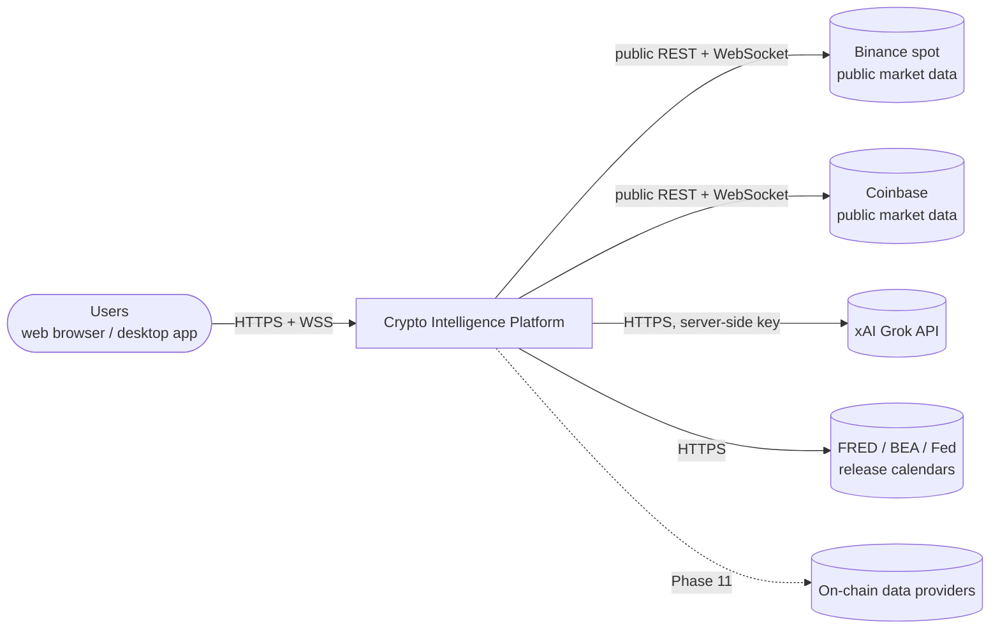
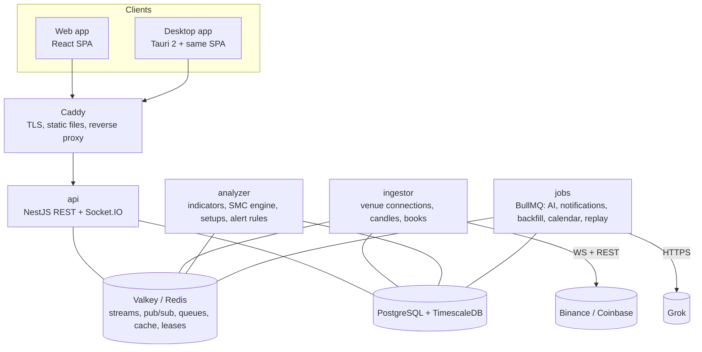
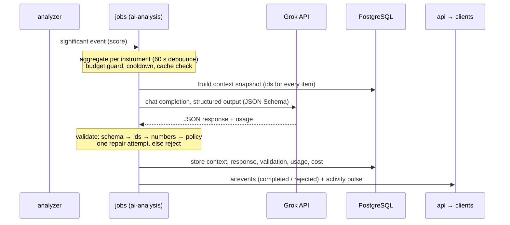

# 03 · Architecture

| | |
|---|---|
| Status | Approved 2026-11-10 (Phase 0 sign-off, recommended defaults) |
| Date | 2026-11-09 |
| Related | [Requirements analysis](01-requirements-analysis.md) · [Data model](05-data-model.md) · [API contracts](06-api-contracts.md) · [SMC rulebook](07-smc-rulebook.md) · [Feasibility](02-feasibility.md) (verified versions and vendor facts) |

## 1. Principles

1. **Real data, real processing.** No production code path produces simulated values. A *replay venue* exists for tests and demos, and the UI always labels it as a replay.
2. **Deterministic core, I/O at the edges.** Indicators and the SMC engine are pure TypeScript packages. Services wrap them with persistence, messaging and networking.
3. **The database is the source of truth.** Redis carries notifications, queues, caches and leases. Everything in Redis can be rebuilt.
4. **One code path for live and replay.** Replays run the same engine over stored candles.
5. **Fail visibly.** Data gaps, delays, paused analysis, budget stops and errors are shown in the UI, never hidden.
6. **Secure by default.** No secrets in clients, least privilege everywhere, every sensitive action audited.
7. **Boring infrastructure first.** One PostgreSQL/TimescaleDB, one Redis-compatible store and Docker Compose. Kubernetes only when scale demands it.

## 2. System context



## 3. Containers



| Service | Responsibility | Scaling | State |
|---|---|---|---|
| **api** | REST API, Socket.IO gateway, authentication, RBAC, audit logging | Stateless; horizontal behind Caddy (Socket.IO Redis adapter, WebSocket-only transport) | None |
| **ingestor** | Venue connections, normalisation, candle building, order books, gap and delay detection, large trades, walls, cross-venue spread, feed health | One active instance per venue (Redis lease); optional warm standby | In-memory order books, rebuilt from snapshots |
| **analyzer** | Indicators, SMC engine, setups, checklist, outcomes, alert-rule evaluation | Partitioned by instrument through Redis leases; add instances to scale | Engine state, checkpointed to PostgreSQL |
| **jobs** | BullMQ processors: AI analysis, notifications, backfill, calendar sync, pair-status polling, closure-calendar generation, replays, maintenance, on-chain (Phase 11) | Horizontal; per-queue concurrency and rate limits | None |
| **PostgreSQL + TimescaleDB** | All durable data | Vertical first; read replica later | Durable |
| **Valkey / Redis** | Streams, pub/sub, BullMQ, caches, leases, Socket.IO adapter | Single node (AOF enabled for BullMQ) | Rebuildable, except queued jobs |
| **Caddy** | TLS (automatic certificates), static web hosting, reverse proxy | Single | None |

All four backend services ship in one `server` image with different entrypoints.

## 4. Monorepo

pnpm workspaces + Turborepo + TypeScript project references.

```
apps/
  api/                NestJS: REST + Socket.IO gateway
  ingestor/           NestJS standalone: venue connections → normalised market data
  analyzer/           NestJS standalone: indicators, SMC engine, setups, alert evaluation
  jobs/               NestJS standalone: BullMQ processors
  web/                Vite host for the shared React app
  desktop/            Tauri 2 host (src-tauri) for the same React app
packages/
  contracts/          zod schemas + inferred types: REST, WebSocket, events, AI input/output, profile parameters
  domain/             entities and value objects: Instrument, Timeframe, Candle, decimal helpers, time alignment, position-size calculator
  exchange-adapters/  Binance, Coinbase and replay venues (framework-free)
  market-data/        candle builder, order-book engine, gap detector (framework-free)
  indicators/         streaming + batch indicators
  smc-engine/         SMC reducer, rules, patterns, labelled fixtures
  ai/                 LLM provider interface, Grok provider, prompt templates, context builder, validators
  db/                 SQL migrations, Kysely types, repositories
  app/                React application: routes, pages, state, platform interface
  ui/                 design system: theme tokens, shadcn/ui components, charts, 3D brain
  observability/      logger, metrics and tracing setup
  config/             shared tsconfig, ESLint and Tailwind presets
tools/
  reference-data/     Python (TA-Lib) scripts that generate indicator reference datasets
  recorder/           records raw venue messages for replay fixtures
infra/
  docker/             Dockerfiles, Compose files (dev, staging, prod), Caddyfile
docs/
```

**Dependency rules** (enforced in CI with dependency-cruiser):

- `contracts` depends only on zod. `domain` depends on nothing internal.
- `indicators`, `market-data` and `smc-engine` depend only on `domain` (and `smc-engine` on `indicators` for ATR). They never import NestJS, Redis or database code.
- `app` and `ui` import only `contracts` and `domain` from the server side.
- Packages never import apps.

**Inside each NestJS app**, clean architecture layers: *domain* (from packages) → *application* (use cases and ports) → *infrastructure* (Kysely repositories, Redis, BullMQ, venue clients, Grok) → *interface* (controllers, gateways). Ports let tests swap in fakes.

## 5. Market data pipeline

### 5.1 Venue adapters

- Each adapter maps a venue's messages to normalised events: `TradeEvent`, `BookSnapshot`, `BookDelta` (with sequence range), `TickerEvent`, `VenueKline` (Binance), `Heartbeat` and `VenueStatus`. Venue-specific channels, limits and sync rules are in [feasibility §3](02-feasibility.md#3-market-data-venues).
- A connection manager per venue:
  - spreads streams across connections within the venue's limits;
  - reconnects with exponential backoff and jitter (1 s → 30 s);
  - reconnects proactively before the venue's maximum connection lifetime;
  - answers pings and keeps a subscription registry so it can resubscribe automatically.
- A REST budgeter per venue mirrors the venue's request-weight rules as a token bucket. It honours `Retry-After` and pauses completely on 429 or 418 responses.

### 5.2 Candles

- **1m is the base timeframe.** 5m, 15m, 1h, 4h and 1d are aggregated from final 1m candles, aligned to UTC.
- **Binance**: the venue's 1m kline stream is authoritative for OHLCV (`source = exchange_kline`). Trades fill the micro volume profile (rulebook §3.5) and taker volume.
- **Coinbase**: 1m candles are built from trades (`source = trades`), because Coinbase has no 1m candle stream.
  - A candle is finalised 2† s after the minute boundary.
  - Missed trades are detected from the per-product `sequence` and the `last_trade_id` in the 1 s heartbeat. If a gap happened during that minute, the candle is repaired from REST before it's finalised (`quality = repaired`).
  - Coinbase REST has no 4h granularity, so 4h is always aggregated from 1h.
- **Minutes with no trades** get a flat candle (O = H = L = C = previous close, volume 0), so every minute exists on both venues. Coinbase REST omits empty intervals; the builder fills them in.
- All candles that close at the same boundary are written in one transaction. Then a wake-up entry goes to `md:candles:{instrumentId}`.
- **Consistency checks**: Binance 1m, 1h, 4h and 1d are compared nightly against the venue's REST klines (an exact match is expected). Coinbase 1h and 1d are compared against REST candles, and any differences are reported.

### 5.3 Order books

- One local L2 book per instrument, maintained with the venue's snapshot + delta procedure and validated by sequence number. On any inconsistency the book is discarded and re-snapshotted, and a `depth` gap is recorded.
- Outputs:
  - a conflated top-50 snapshot to clients at 10 Hz;
  - 1 Hz metrics to the database (spread and depth within ±0.1%, ±0.5% and ±1%, plus imbalance);
  - a full snapshot to the database every 10 s;
  - wall detection (§5.6).

### 5.4 Gap and delay detection

| Signal | Detected by | Action |
|---|---|---|
| Sequence gap | Book update IDs, trade IDs, feed sequence numbers | Record a `data_gaps` row, resync the book, schedule a backfill |
| Silent stream | No message or heartbeat within max(30 s, 3 × the expected interval) | Reconnect; the gap starts at the last message |
| Missing candle close | No final 1m candle 10 s after boundary + grace | Backfill job for that minute |
| Reconnect | Connection lifecycle | Gap from disconnect to the first message after reconnecting; backfill |
| Delay | Exchange event time vs receive time; p50 > 2 s over 60 s | Feed status `degraded (delayed)` |
| Clock drift | Local clock vs venue server time, every 5 min | Health warning above 500 ms (hosts run chrony) |

**Backfill** runs on the `backfill` queue with a per-venue rate limiter. It fetches candles (and trades, where available, for micro profiles), upserts them with `quality = repaired`, closes the gap record and wakes the analyzer. Analysis waits at a gap and resumes in order (rulebook §9), so nothing already published changes.

### 5.5 Instruments, pair status and gold specifics

- Instruments live in the database. The ingestor listens on `config:instruments` and subscribes or unsubscribes live, with no restart.
- Pair status is polled every 5 min (`pair-status` job). A halted or delisted pair stops its feed, keeps its history and raises a health alert.
- **Gold-market closure calendar**: a weekly rule in `America/New_York` (closed Friday 17:00 → Sunday 18:00, plus the daily 17:00–18:00 break) generates closures 8 weeks ahead, every day. Admins add holidays. The candle builder sets `underlying_closed`.
- **Cross-venue spread**: computed every second from tickers, as Binance PAXG/USDT × Coinbase USDT-USD vs Coinbase PAXG-USD. A row is stored every 10 s and the value is fed to alert evaluation.

### 5.6 Exchange whale signals

- **Large trades**: threshold = max(floorUsd, the 99.9th percentile of trade notional over the trailing 24 h), per instrument. Fills are grouped into one taker order before thresholding:
  - **Coinbase**: by `taker_order_id`, which the `matches` channel provides.
  - **Binance**: an aggTrade covers one taker order *at one price*. Consecutive aggTrades with the same event time, the same side and contiguous trade ids are merged into one sweep.
  - **Other cases**: same-side fills within 250 ms.
- **Walls**: a price level whose notional is ≥ 10† × the median level notional within ±1% of mid, and above a floor. Each wall's lifetime is tracked, and its removal is classified as `filled` (traded through) or `pulled` (cancelled).

## 6. Event backbone

| Mechanism | Name | From → to | Purpose |
|---|---|---|---|
| Stream | `md:candles:{instrumentId}` | ingestor → analyzer | Wake-up signal: candles are final at boundary t. The analyzer reads the candles from PostgreSQL. |
| Stream | `md:events` | ingestor → api, jobs | Gaps, feed status, large trades, walls, spreads |
| Stream | `an:events` | analyzer → api, jobs | Indicator updates, SMC detections, setup transitions |
| Stream | `ai:events` | jobs → api | AI analysis lifecycle |
| Stream | `alerts:events` | analyzer → jobs, api | Fired alerts |
| Stream | `sys:activity` | all → api | Activity counters for the 3D view |
| Pub/sub (Socket.IO Redis emitter) | rooms `ticker:*`, `book:*`, `candles:*` | ingestor → api → clients | High-frequency, conflated, no replay |
| BullMQ | `ai-analysis`, `notifications`, `backfill`, `replay`, `calendar-sync`, `pair-status`, `closure-calendar`, `maintenance`, `onchain` | → jobs | Units of work with retries, rate limits and scheduling |

- Streams are capped (`MAXLEN ~`) at about 7 days of entries. Every api instance reads every stream with its own cursor, so each one can fan out to its own clients.
- **Leases** (`lease:ingestor:{venue}`, `lease:analyzer:{instrumentId}`) have a 15 s TTL and are renewed every 5 s. Each lease carries a fencing epoch. Analyzer checkpoints are updated only `WHERE lease_epoch <= $epoch`, so a former owner can't overwrite a newer one.
- **Idempotency**: detection inserts are protected by unique keys that include `run_id`. BullMQ job IDs are deterministic (for example `backfill:{instrumentId}:{gapId}`).

## 7. Analysis pipeline

- **One actor per instrument.** On a wake-up, it loads the next expected candles from PostgreSQL, in order, for every TF that closes at that boundary.
  - If a candle is missing, it waits and reports "paused: data gap".
  - Otherwise it steps the indicators and the SMC engine, then writes the detections, setup transitions and checkpoint in **one transaction**, and publishes to `an:events`.
- **Checkpoints**: engine state is serialised (JSON, gzip) every 60 boundaries and on shutdown. A restart loads the checkpoint and replays the candles since then through the same reducer, so the result is identical.
- **Warm-up**: a new live run (new instrument or new parameters) first replays enough history for every TF (at least 500 candles of the highest TF in use). Warm-up events are stored with a `warmup` flag and never alert.
- **Outcomes** are part of engine state. Ambiguity is resolved with 1m candles (rulebook §6.1).
- **Alert evaluation** runs inside each instrument actor on 1 Hz ticker updates, `an:events` and `md:events`. Rules are cached and refreshed on `config:alerts`. Cooldowns and de-duplication keys live in Redis.
- **Replays** run on the `replay` queue: the same engine, a new `run_id` with `mode = replay`, and a digest that can be compared with the live run.

## 8. AI pipeline



- **Triggers**: every event has a significance score, for example:

  | Event | Score |
  |---|---|
  | Setup confirmed | 100 |
  | MSS on the context TF | 70 |
  | Setup resolved | 60 |
  | Sweep of a day or week level | 50 |
  | Volume anomaly on 1h | 50 |
  | 4-hourly digest | 30 |

  Scores add up per instrument during a 60† s debounce window, and a call is made at ≥ 100. Each instrument has a 15† min cooldown, except for setup confirmations.
- **Budget**: daily and monthly spending caps. At 80% of a cap, only score ≥ 100 events go through; at 100%, calls stop and the UI says "AI budget reached".
- **Cache**: the hash of the canonical context (excluding timestamps). An identical hash within 30 min reuses the earlier result.
- **Context**: built from the database, up to about 8k tokens (lowest-priority items are dropped first):
  - prices and indicators per TF, structure per TF;
  - active levels, zones, and setups with their checklists;
  - the last 6 h of events and the next 48 h of economic events;
  - data-quality flags and gold-market status. Every item has an `id`.
- **Provider**: the `LlmProvider` interface, with `GrokProvider` calling the OpenAI-compatible API with structured outputs. The JSON Schema is generated from the zod contract and stays inside Grok's guaranteed subset ([feasibility §5](02-feasibility.md#5-ai-grok)).
  - Model ids are configuration (pinned).
  - Timeout 30 s; up to 3 retries with backoff on 429/5xx; per-model limiter on the queue.
- **Validation**, in this order:
  1. schema;
  2. every cited id exists in the context;
  3. every number in the text is within 0.05%† of a value in the context;
  4. policy lint (no guarantees or certainty language, no instructions to buy or sell).

  Then one repair attempt that feeds back the validator's errors. If it still fails, the analysis is stored as `rejected` and shown as "analysis unavailable".
- **No free text reaches the model.** On-demand requests pick an instrument and a reason from a fixed list.
- **Only the jobs service holds the Grok key** and has outbound access to xAI.

## 9. Alerts and notifications

- **Rule types** (one typed union in `contracts`):
  - price: `price_cross`, `price_change_pct`;
  - indicators and volume: `indicator_threshold`, `volume_anomaly`;
  - SMC: `smc_event` (sweep, BOS, MSS, POI entry), `setup_transition`;
  - gold and calendar: `spread_threshold`, `economic_event_upcoming`, `gold_market_session`;
  - exchange flow: `large_trade`, `wall`;
  - data health: `feed_health` (halted, delisted, gap).
- Each rule has a scope (instruments, venues, timeframes), cooldown, de-duplication key, quiet hours, severity and channels.
- **Delivery**: the `notifications` queue writes to the in-app inbox and pushes over WebSocket.
  - The desktop app turns pushes into native notifications (Tauri notification plugin).
  - The web app uses the browser Notification API while a tab is open.
  - After reconnecting, a client gets unread items from the inbox. The desktop app shows one summary notification ("5 alerts while you were away") instead of a burst.
- Alerts from catch-up processing are labelled **late**.

## 10. Real-time gateway

- Socket.IO, WebSocket transport only (so no sticky sessions), namespace `/v1`.
- **Auth**: an access token at handshake; the server asks the client to re-authenticate when it expires.
- **Rates**: ticker 4 Hz, book 10 Hz (top 50), in-progress candles 1 Hz; everything else event-driven.
- **Sequencing and resync**: durable channels carry the Redis stream entry id as `seq`. Resync replays from the stream when possible and falls back to a snapshot ([API contracts §5](06-api-contracts.md#5-websocket-protocol)).
- **Backpressure**: conflatable messages are dropped when a socket's buffer is over its limit. A client that stays over the limit for 30 s is disconnected.
- **Authorization**: every authenticated role can read market, analysis and system channels. Alert channels are per user.

## 11. Frontend

- `packages/app`: React, TypeScript, TanStack Router, TanStack Query (REST), Zustand (live state), a Socket.IO connection manager, react-hook-form + zod.
- **Charts**: a candlestick library with custom drawing primitives for zones, levels, sweep markers and closure shading ([feasibility §7](02-feasibility.md#7-stack-versions-and-licences)). Overlays come only from the detection API; the client never detects anything itself.
- **3D**: React Three Fiber, lazy-loaded. Requires WebGL2; otherwise a 2D status card is shown.
- **Design system**: Tailwind + shadcn/ui with dark-theme tokens. Bullish/bearish colours are colour-blind-safe and always paired with an icon or label.
- **Platform interface**: `notify()`, `secureStore`, `openExternal()`, `onSleepWake()` and `appVersion`. The web and Tauri implementations are injected at startup.
- **Connection manager**: states `online` → `reconnecting` → `offline`. After reconnecting it resyncs every subscribed channel. Each widget shows the age of its data when it becomes stale.
- **Budgets**: initial JavaScript ≤ 300 KB gzipped (charts and 3D in separate chunks), route-level code splitting, virtualised tables.

## 12. 3D visualization

The brain is a live view of system activity, divided into regions mapped to subsystems: **ingestion**, **analysis**, **AI** and **alerts**.

| Visual state | Condition (from the `system:activity` feed) | Appearance |
|---|---|---|
| Disconnected | No activity snapshot for 3 s, or socket down | Dim, grey, almost still; "Disconnected" label |
| Error | Any component reports `critical` | That component's region pulses red; label names the component |
| Analysing | `analysis.activeJobs > 0` or `ai.inflight > 0` | Faster node firing; AI region brightens while a call is in flight |
| Receiving | `ingest.msgsPerSec` above the idle threshold | Particle flow along ingestion paths, speed from the message rate |
| Idle | None of the above | Slow breathing animation |
| Pulse overlays | `pattern` and `ai_completed` pulses | Local flash in the analysis region; completion wave from the AI region |

- Mappings are deterministic functions of the metrics. For example, particle speed = clamp(log10(1 + msgsPerSec) / 3, 0.05, 1), and firing rate is proportional to active jobs.
- Randomness is used only as seeded spatial noise for particle placement. It never drives state or rates. A test feeds zero activity and asserts the scene settles at idle parameters.
- **Performance**: instanced meshes, up to 20k particles by default, adaptive quality, rendering paused while hidden, and a reduced-motion mode. A text status line is always next to the canvas.

## 13. Desktop (Tauri 2)

- Uses the same `packages/app` build with the Tauri platform implementation.
- **First run**: server URL, then login. The refresh token goes into the OS keychain through a small Rust command (`keyring` crate); the access token is kept in memory.
- **Capabilities** are limited to: notifications, window state, tray, optional autostart, the keyring command, and opening external links. No shell access and no filesystem access beyond app config.
- **CSP**: `default-src 'self'; connect-src https://<server> wss://<server>; img-src 'self' data:`. No remote scripts.
- Sleep/wake and network changes trigger reconnect and resync.
- The tray shows connection status and unread alerts.
- Updates use the Tauri updater with signed manifests (Phase 13). CI builds Windows x64 and macOS universal bundles.

## 14. Security

**Authentication**

- Local accounts with argon2id password hashes. TOTP MFA is mandatory for admins.
- Access tokens: JWT, 15 min, EdDSA signing keys rotated.
- Refresh tokens: opaque, stored hashed, rotated with reuse detection, 14 days.
- Web keeps the refresh token in an httpOnly Secure SameSite=Strict cookie; desktop keeps it in the OS keychain.
- Login rate limiting and progressive lockout. OIDC single sign-on can be added later.

**Authorization**: role-based, enforced on every route and channel. The default is deny.

| Capability | viewer | analyst | admin |
|---|---|---|---|
| View dashboards, charts, setups, AI history | ✓ | ✓ | ✓ |
| Personal alert rules and notifications | ✓ | ✓ | ✓ |
| Request on-demand AI analysis (budgeted) | | ✓ | ✓ |
| Run replays; label fixtures | | ✓ | ✓ |
| Manage instruments, profiles and settings (AI budget, thresholds) | | | ✓ |
| Manage users; view the audit log | | | ✓ |

**Audit log**

- Append-only, with a SHA-256 hash chain computed by a database trigger. The application's database role can't update or delete rows.
- Logged events: logins (success and failure), MFA changes, user and role changes, instrument, profile and settings changes, alert-rule changes, on-demand AI requests, replays and exports.

**Secrets**

- Environment variables or Docker secrets, validated with zod at startup. Pino redacts them from logs.
- The Grok key and provider keys exist only in the `jobs` service.
- Each service has its own least-privilege database credentials.

**Transport**: TLS with HSTS through Caddy. PostgreSQL and Redis sit on an internal network only. Redis uses ACL users per service.

**Input and output handling**

- zod validation on every request and WebSocket message.
- AI text is rendered as plain text, never as HTML.
- CSP; CORS allowlist (web origin and Tauri origins); per-user and per-IP rate limits; request size limits.

**Supply chain**: lockfile, OSV scanning, Renovate, Trivy image scans, a CycloneDX SBOM per release, and base images pinned by digest.

**No trading**: no exchange private endpoint is implemented. A CI check fails if adapter code references order endpoints.

## 15. Data storage

- **PostgreSQL + TimescaleDB** (versions pinned in [feasibility §7](02-feasibility.md#7-stack-versions-and-licences)).
  - One schema per area: `market`, `analysis`, `ai`, `alerts`, `app`, `ops`. Tables are defined in the [data model](05-data-model.md).
  - Migrations are SQL-first (Kysely migrator), with types generated from the database. They follow expand/contract so deployments never need a down-migration.
- **Valkey/Redis**: AOF `everysec`, so queued jobs survive restarts, and `maxmemory-policy noeviction`, which BullMQ requires. No other durable data.
- **Backups**: pgBackRest physical backups with WAL archiving: a nightly full backup, continuous WAL, 14-day retention and an offsite copy. A restore drill runs before every release.

## 16. Observability

- **Logs**: pino JSON with `service`, `instance`, `correlationId`, `instrumentId` and `venue`, written to stdout.
- **Metrics**: OpenTelemetry, exported for Prometheus:
  - feeds: messages/s, lag histograms, reconnects, open gaps;
  - analysis: candle finalisation latency, engine step time, detection latency;
  - queues: depth and wait time;
  - AI: calls, tokens, cost, latency, rejections;
  - gateway and API: clients, messages, latency, errors.
- **Traces**: OpenTelemetry for API requests and AI jobs.
- **System Health page**: reads `GET /api/v1/system/health`, built from service heartbeats in Redis and feed status. It doesn't depend on Prometheus.
- **Operator alerts** (Alertmanager or Grafana) are separate from user alerts.

## 17. Deployment

- **Images**: the `server` image (four entrypoints) and the web assets served by Caddy. Multi-stage builds, a non-root user, base images pinned by digest.
- **Compose stacks** for `dev` (hot reload), `staging` and `prod` (single VM), with health checks, restart policies and resource limits.
- **Hosting**: start with a VM of 4 vCPU, 16 GB RAM and 200 GB SSD, in a region where Binance's public API is reachable ([feasibility §3](02-feasibility.md#3-market-data-venues)). chrony for time sync. Only port 443 is open.
- **Scaling path**: more analyzer replicas (instrument leases), more api replicas, a separate database host. Kubernetes only if needed.

## 18. CI/CD

GitHub Actions + GitHub Container Registry (decision D7).

| Trigger | Pipeline |
|---|---|
| Pull request | install (cached) → lint + typecheck + dependency rules → unit, golden and property tests with coverage gates → integration tests (Testcontainers: TimescaleDB, Valkey) → build images → e2e (Compose + replay venue + Playwright) → security scans |
| Merge to main | images tagged with the commit SHA → automatic deploy to staging (migrations run first as a one-shot step) |
| Production | manual approval → same images → migrations → rolling restart |
| Desktop tag (`desktop-v*`) | Windows and macOS bundles (signed from Phase 13) attached to the release, plus the updater manifest |
| Nightly | live smoke tests against the venues' public APIs (catch API changes) and a 1-hour soak in staging |

## 19. Testing strategy

| Level | Scope | Tools |
|---|---|---|
| Unit | Pure packages | Vitest |
| Golden | Indicators vs TA-Lib reference data; SMC fixtures | Vitest |
| Property | Engine invariants, prefix stability (no repaint) | fast-check |
| Contract | Adapters parse recorded venue payloads; nightly live smoke | Vitest |
| Integration | Services with a real database and Redis | Testcontainers |
| End-to-end | User flows in the web app | Playwright against Compose with the replay venue |
| Chaos | Disconnects, latency, Redis/PostgreSQL restarts | Toxiproxy |
| Performance | Engine benchmarks; API and WebSocket load | Vitest bench, k6 |
| Soak | 24 h with live data in staging | Metrics dashboards |
| Desktop | Packaged-app smoke tests on Windows and macOS | tauri-driver (Windows); scripted manual checklist on macOS |

## 20. Architecture decisions (summary)

Full ADRs are written in Phase 1 under `docs/adr/`.

| ADR | Decision | Main alternative |
|---|---|---|
| 001 | pnpm workspaces + Turborepo | Nx (more features, more weight) |
| 002 | Four NestJS apps sharing framework-free packages | One monolith process (simpler, but couples latency-sensitive ingestion to CPU-heavy analysis) |
| 003 | Redis Streams for data flow, BullMQ for units of work | BullMQ for everything (per-candle jobs lose ordering) or Kafka (heavy for this scale) |
| 004 | SMC engine as an event-sourced pure reducer with checkpoints | Recomputing over a sliding window (causes repainting at the window edge) |
| 005 | Analysis pauses at data gaps | Recompute after repair (changes published detections) |
| 006 | Kysely + SQL-first migrations | Drizzle or Prisma (weaker at TimescaleDB-specific DDL) |
| 007 | Socket.IO, WebSocket-only, Redis adapter and emitter | Raw `ws` (more code for rooms, acks and reconnection) |
| 008 | Desktop is a thin Tauri client of the same backend | Embedded local backend (offline, much larger) |
| 009 | Built-in auth (argon2id, TOTP, rotating refresh tokens) | External OIDC provider (better for SSO, extra dependency) |
| 010 | Valkey as the Redis-compatible store (decision D4) | Redis 8 |
| 011 | AI cites ids from a provided context; server validates grounding | Free-form analysis (can invent levels) |
| 012 | Indicator reference data generated with TA-Lib in a dev-only Python tool | Hand-computed spreadsheets (slow, error-prone) |
