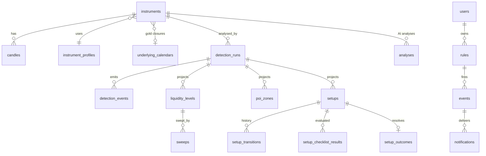

# 05 · Data model

| | |
|---|---|
| Status | Approved 2026-11-10 (Phase 0 sign-off, recommended defaults) |
| Date | 2026-11-09 |
| Database | PostgreSQL 18 + TimescaleDB 2.31 ([feasibility §7](02-feasibility.md#7-stack-versions-and-licences)) |

This is the logical schema. Phase 1 turns it into SQL migrations. TimescaleDB recently renamed its compression API to "columnstore", so the exact policy function names are confirmed when the first migration is written. The settings to apply are in §8.

## 1. Conventions

- **IDs**: UUIDv7, generated by the application (time-ordered, index-friendly).
- **Time**: `timestamptz`, stored in UTC. Candles are keyed by their open time.
- **Prices and quantities**: `numeric` (exact; values arrive as decimal strings). Indicator outputs: `double precision`.
- **Enumerations**: `text` with a `CHECK` constraint, which is easier to extend than PostgreSQL enums.
- **Detections belong to a run.** Every SMC and indicator row has a `run_id`. A run fixes the instrument, profile version, ruleset version and parameter hash, and is either `live` or `replay`. Replays never mix with live data.
- **Event log + projections.** `analysis.detection_events` is the append-only record of everything the engine emitted, and the source for determinism digests. Tables such as `liquidity_levels`, `poi_zones` and `setups` are queryable projections of the current state. Both are written in the same transaction.
- **Schemas**: `app` (users, auth, audit, settings), `market`, `analysis`, `ai`, `alerts`, `ops`.

## 2. Overview



## 3. `app`: users, authentication, audit, settings

```sql
CREATE TABLE app.users (
  id              uuid PRIMARY KEY,
  email           citext NOT NULL UNIQUE,
  display_name    text NOT NULL,
  password_hash   text NOT NULL,                        -- argon2id
  role            text NOT NULL CHECK (role IN ('admin','analyst','viewer')),
  mfa_secret_enc  bytea,                                -- TOTP secret, encrypted with a server key
  mfa_last_used_step integer,                           -- Phase 1: last accepted TOTP step (replay protection)
  status          text NOT NULL DEFAULT 'active' CHECK (status IN ('active','locked','disabled')),
  failed_logins   int  NOT NULL DEFAULT 0,
  locked_until    timestamptz,
  password_changed_at timestamptz NOT NULL DEFAULT now(), -- Phase 1: access tokens issued earlier are refused
  created_at      timestamptz NOT NULL DEFAULT now(),
  updated_at      timestamptz NOT NULL DEFAULT now(),   -- Phase 1
  last_login_at   timestamptz
);

CREATE TABLE app.refresh_tokens (
  id            uuid PRIMARY KEY,
  user_id       uuid NOT NULL REFERENCES app.users(id),
  family_id     uuid NOT NULL,                          -- reuse of a rotated token revokes the family
  token_hash    bytea NOT NULL UNIQUE,                  -- SHA-256 of the opaque token
  client        text NOT NULL CHECK (client IN ('web','desktop')),
  device_label  text,
  created_at    timestamptz NOT NULL DEFAULT now(),
  expires_at    timestamptz NOT NULL,
  revoked_at    timestamptz,
  replaced_by   uuid REFERENCES app.refresh_tokens(id)
);

CREATE TABLE app.audit_log (
  id             bigint GENERATED ALWAYS AS IDENTITY PRIMARY KEY,
  chain_seq      bigint NOT NULL UNIQUE,                -- Phase 1: chain order, assigned under the lock
  at             timestamptz NOT NULL DEFAULT now(),
  actor_type     text NOT NULL CHECK (actor_type IN ('user','system')),
  actor_user_id  uuid REFERENCES app.users(id),
  action         text NOT NULL,                         -- e.g. 'auth.login.failed', 'profile.update'
  target_type    text,
  target_id      text,
  ip             inet,
  user_agent     text,
  details        jsonb NOT NULL DEFAULT '{}',
  prev_hash      bytea NOT NULL,
  hash           bytea NOT NULL                         -- sha256(prev_hash || canonical row)
);
-- A BEFORE INSERT trigger takes an advisory lock, reads the latest hash and fills chain_seq/prev_hash/hash.
-- The application role is granted INSERT and SELECT only: no UPDATE, DELETE or TRUNCATE.
-- Phase 1 additions: a second trigger refuses UPDATE, DELETE and TRUNCATE even for the owner, and
-- app.verify_audit_chain() walks the chain and returns the first sequence that does not verify.
-- The digest covers chain_seq, the time as epoch microseconds and every column, as canonical JSON
-- (migration 0003_audit_log.sql).

CREATE TABLE app.settings (
  key         text PRIMARY KEY,                         -- 'ai.budget', 'ai.models', 'alerts.defaults', ...
  value       jsonb NOT NULL,                           -- validated by a zod schema per key
  updated_by  uuid REFERENCES app.users(id),
  updated_at  timestamptz NOT NULL DEFAULT now()
);

CREATE TABLE app.user_preferences (
  user_id     uuid PRIMARY KEY REFERENCES app.users(id),
  prefs       jsonb NOT NULL DEFAULT '{}',              -- display time zone, watchlist, layouts
  updated_at  timestamptz NOT NULL DEFAULT now()
);
```

## 4. `market`: reference data and market data

```sql
CREATE TABLE market.venues (
  id       text PRIMARY KEY CHECK (id IN ('binance','coinbase','replay')),
  name     text NOT NULL,
  enabled  boolean NOT NULL DEFAULT true
);

CREATE TABLE market.instrument_profiles (
  id           uuid PRIMARY KEY,
  name         text NOT NULL,                           -- 'crypto-majors', 'gold'
  version      int  NOT NULL,
  params       jsonb NOT NULL,                          -- validated by contracts ProfileParams
  params_hash  text NOT NULL,                           -- sha256 of the canonical params
  created_by   uuid REFERENCES app.users(id),
  created_at   timestamptz NOT NULL DEFAULT now(),
  UNIQUE (name, version)                                -- profiles are immutable; changes create a version
);

CREATE TABLE market.underlying_calendars (
  id           text PRIMARY KEY,                        -- 'gold'
  time_zone    text NOT NULL,                           -- 'America/New_York'
  weekly_rule  jsonb NOT NULL                           -- weekly close/open and daily break
);

CREATE TABLE market.underlying_market_closures (
  calendar_id  text NOT NULL REFERENCES market.underlying_calendars(id),
  starts_at    timestamptz NOT NULL,
  ends_at      timestamptz NOT NULL CHECK (ends_at > starts_at),
  reason       text NOT NULL CHECK (reason IN ('weekend','daily_break','holiday')),
  source       text NOT NULL CHECK (source IN ('generated','manual')),
  PRIMARY KEY (calendar_id, starts_at)
);

CREATE TABLE market.instruments (
  id                      uuid PRIMARY KEY,
  venue_id                text NOT NULL REFERENCES market.venues(id),
  venue_symbol            text NOT NULL,                -- 'PAXGUSDT', 'PAXG-USD'
  base_asset              text NOT NULL,
  quote_asset             text NOT NULL,
  asset_class             text NOT NULL CHECK (asset_class IN ('crypto','tokenised_gold','stablecoin')),
  role                    text NOT NULL DEFAULT 'monitored' CHECK (role IN ('monitored','reference')),
  price_tick              numeric NOT NULL,
  qty_step                numeric NOT NULL,
  profile_id              uuid REFERENCES market.instrument_profiles(id),
  underlying_calendar_id  text REFERENCES market.underlying_calendars(id),
  is_primary_venue        boolean NOT NULL DEFAULT true,   -- PAXG: Binance true, Coinbase false
  store_raw_trades        boolean NOT NULL DEFAULT true,
  venue_status            text NOT NULL DEFAULT 'unknown' CHECK (venue_status IN ('trading','halted','delisted','unknown')),
  enabled                 boolean NOT NULL DEFAULT true,
  created_at              timestamptz NOT NULL DEFAULT now(),
  updated_at              timestamptz NOT NULL DEFAULT now(),
  UNIQUE (venue_id, venue_symbol)
);
```

### 4.1 Time series

```sql
CREATE TABLE market.candles (                           -- hypertable on open_time
  instrument_id      uuid NOT NULL,
  timeframe          text NOT NULL CHECK (timeframe IN ('1m','5m','15m','1h','4h','1d')),
  open_time          timestamptz NOT NULL,
  open               numeric NOT NULL,
  high               numeric NOT NULL,
  low                numeric NOT NULL,
  close              numeric NOT NULL,
  volume             numeric NOT NULL,                  -- base asset
  quote_volume       numeric NOT NULL,
  trade_count        int,
  taker_buy_volume   numeric,
  micro_profile      real[],                            -- 1m only: base volume per bucket between low and high (rulebook §3.5)
  source             text NOT NULL CHECK (source IN ('exchange_kline','trades','rest','aggregated','replay')),
  quality            text NOT NULL CHECK (quality IN ('complete','repaired','partial')),
  underlying_closed  boolean NOT NULL DEFAULT false,
  finalized_at       timestamptz NOT NULL,
  PRIMARY KEY (instrument_id, timeframe, open_time)
);

CREATE TABLE market.trades (                            -- hypertable on ts
  instrument_id    uuid NOT NULL,
  ts               timestamptz NOT NULL,                -- venue trade time
  trade_id         text NOT NULL,
  price            numeric NOT NULL,
  qty              numeric NOT NULL,
  taker_side       text NOT NULL CHECK (taker_side IN ('buy','sell')),
  taker_order_ref  text,                                -- Coinbase taker_order_id, or the merged Binance aggTrade group
  received_at      timestamptz NOT NULL,
  PRIMARY KEY (instrument_id, ts, trade_id)
);

CREATE TABLE market.orderbook_metrics (                 -- hypertable on ts, one row per second
  instrument_id    uuid NOT NULL,
  ts               timestamptz NOT NULL,
  mid              numeric NOT NULL,
  spread_bps       double precision NOT NULL,
  bid_usd_10bp     double precision,  ask_usd_10bp   double precision,   -- depth within ±0.1%
  bid_usd_50bp     double precision,  ask_usd_50bp   double precision,   -- ±0.5%
  bid_usd_100bp    double precision,  ask_usd_100bp  double precision,   -- ±1%
  imbalance_10bp   double precision,                    -- (bid − ask) / (bid + ask)
  imbalance_50bp   double precision,
  imbalance_100bp  double precision,
  coverage_bps     double precision,                    -- how far from mid the local book is known
  PRIMARY KEY (instrument_id, ts)
);

CREATE TABLE market.orderbook_snapshots (               -- hypertable on ts, one row per 10 s
  instrument_id  uuid NOT NULL,
  ts             timestamptz NOT NULL,
  bids           numeric[] NOT NULL,                    -- flattened [price, qty, price, qty, …], best first, top 50
  asks           numeric[] NOT NULL,
  venue_seq      text,
  PRIMARY KEY (instrument_id, ts)
);

CREATE TABLE market.cross_venue_spreads (               -- hypertable on ts, one row per 10 s
  base_asset               text NOT NULL,               -- 'PAXG'
  ts                       timestamptz NOT NULL,
  primary_instrument_id    uuid NOT NULL,
  secondary_instrument_id  uuid NOT NULL,
  primary_usd              numeric NOT NULL,            -- USDT price × USDT-USD
  secondary_usd            numeric NOT NULL,
  usdt_usd                 numeric NOT NULL,
  spread_bps               double precision NOT NULL,   -- (secondary − primary) / primary
  PRIMARY KEY (base_asset, ts)
);

CREATE TABLE market.feed_events (                       -- hypertable on ts
  ts             timestamptz NOT NULL,
  venue_id       text NOT NULL,
  instrument_id  uuid,
  event          text NOT NULL CHECK (event IN ('connected','disconnected','reconnecting','resubscribed',
                                                'rate_limited','delayed','recovered','error','status_change')),
  details        jsonb NOT NULL DEFAULT '{}'
);
```

### 4.2 Events and reference tables

```sql
CREATE TABLE market.large_trades (
  id              uuid PRIMARY KEY,
  instrument_id   uuid NOT NULL REFERENCES market.instruments(id),
  ts              timestamptz NOT NULL,
  taker_side      text NOT NULL CHECK (taker_side IN ('buy','sell')),
  avg_price       numeric NOT NULL,
  qty             numeric NOT NULL,
  notional_usd    numeric NOT NULL,
  grouping        text NOT NULL CHECK (grouping IN ('single','taker_order','burst')),
  fill_count      int NOT NULL,
  price_levels    int NOT NULL,
  threshold_usd   numeric NOT NULL                      -- the threshold in force at the time
);
CREATE INDEX ON market.large_trades (instrument_id, ts DESC);

CREATE TABLE market.orderbook_walls (
  id                uuid PRIMARY KEY,
  instrument_id     uuid NOT NULL REFERENCES market.instruments(id),
  side              text NOT NULL CHECK (side IN ('bid','ask')),
  price             numeric NOT NULL,
  first_seen        timestamptz NOT NULL,
  last_seen         timestamptz NOT NULL,
  max_notional_usd  numeric NOT NULL,
  ended_reason      text CHECK (ended_reason IN ('filled','pulled','unknown'))
);
CREATE INDEX ON market.orderbook_walls (instrument_id, first_seen DESC);

CREATE TABLE market.data_gaps (
  id             uuid PRIMARY KEY,
  instrument_id  uuid NOT NULL REFERENCES market.instruments(id),
  stream         text NOT NULL CHECK (stream IN ('trades','depth','kline','ticker')),
  gap_start      timestamptz NOT NULL,
  gap_end        timestamptz,
  detected_at    timestamptz NOT NULL,
  detected_by    text NOT NULL CHECK (detected_by IN ('sequence','heartbeat','timer','reconnect','consistency_check')),
  status         text NOT NULL CHECK (status IN ('open','backfilling','repaired','unrepairable')),
  resolved_at    timestamptz,
  details        jsonb NOT NULL DEFAULT '{}'
);
CREATE INDEX ON market.data_gaps (instrument_id, status);

CREATE TABLE market.economic_events (
  id              uuid PRIMARY KEY,
  source          text NOT NULL,                        -- 'fred', 'bea', 'fed', 'manual'
  source_ref      text NOT NULL,
  title           text NOT NULL,
  country         text NOT NULL DEFAULT 'US',
  currency        text NOT NULL DEFAULT 'USD',
  category        text NOT NULL,                        -- 'inflation', 'employment', 'central_bank', 'growth', …
  impact          text NOT NULL CHECK (impact IN ('low','medium','high')),
  scheduled_at    timestamptz NOT NULL,
  time_confirmed  boolean NOT NULL,                     -- false when only the date is published and the time is the standard one
  actual          text,
  forecast        text,
  previous        text,
  updated_at      timestamptz NOT NULL DEFAULT now(),
  UNIQUE (source, source_ref)
);
CREATE INDEX ON market.economic_events (scheduled_at);
```

## 5. `analysis`: runs, indicators and SMC detections

```sql
CREATE TABLE analysis.detection_runs (
  id               uuid PRIMARY KEY,
  mode             text NOT NULL CHECK (mode IN ('live','replay')),
  instrument_id    uuid NOT NULL REFERENCES market.instruments(id),
  profile_id       uuid NOT NULL REFERENCES market.instrument_profiles(id),
  ruleset_version  text NOT NULL,
  params_hash      text NOT NULL,
  from_time        timestamptz NOT NULL,
  to_time          timestamptz,                         -- null while a live run is open
  status           text NOT NULL CHECK (status IN ('warming_up','running','completed','failed','superseded')),
  requested_by     uuid REFERENCES app.users(id),       -- replays
  result_digest    text,                                -- sha256 over the canonical event list
  started_at       timestamptz NOT NULL DEFAULT now(),
  finished_at      timestamptz
);
CREATE UNIQUE INDEX one_open_live_run ON analysis.detection_runs (instrument_id)
  WHERE mode = 'live' AND status IN ('warming_up','running');

CREATE TABLE analysis.engine_checkpoints (
  run_id         uuid PRIMARY KEY REFERENCES analysis.detection_runs(id),
  last_boundary  timestamptz NOT NULL,                  -- last processed candle close
  lease_epoch    bigint NOT NULL,                       -- fencing token; updates require epoch >= stored
  state          bytea NOT NULL,                        -- gzip(JSON) engine state
  updated_at     timestamptz NOT NULL DEFAULT now()
);

CREATE TABLE analysis.detection_events (                -- hypertable on candle_time; append-only
  run_id         uuid NOT NULL,
  seq            bigint NOT NULL,                       -- per-run sequence
  candle_time    timestamptz NOT NULL,                  -- close time of the deciding candle
  instrument_id  uuid NOT NULL,
  timeframe      text NOT NULL,
  type           text NOT NULL,                         -- 'swing_confirmed', 'structure', 'range_detected', 'level_created',
                                                        -- 'level_status', 'sweep', 'zone_created', 'zone_status', 'setup_transition', …
  entity_id      uuid,
  payload        jsonb NOT NULL,
  PRIMARY KEY (run_id, seq, candle_time)
);

CREATE TABLE analysis.indicator_values (                -- hypertable on open_time
  instrument_id   uuid NOT NULL,
  timeframe       text NOT NULL,
  open_time       timestamptz NOT NULL,
  run_id          uuid NOT NULL,
  rsi             double precision,
  macd            double precision,
  macd_signal     double precision,
  macd_hist       double precision,
  ema_fast        double precision,                     -- 20 by default
  ema_mid         double precision,                     -- 50
  ema_slow        double precision,                     -- 200
  vwap            double precision,                     -- anchored daily (UTC) by default
  atr             double precision,
  volume_z        double precision,                     -- robust z-score (median/MAD)
  volume_anomaly  boolean,
  trend           text CHECK (trend IN ('bullish','bearish','neutral')),
  trend_strength  double precision,
  PRIMARY KEY (instrument_id, timeframe, open_time, run_id)
);
```

### 5.1 SMC projections

Common columns on every projection: `run_id uuid NOT NULL REFERENCES analysis.detection_runs(id)`, `instrument_id uuid NOT NULL`, and `flags text[] NOT NULL DEFAULT '{}'` (for example `warmup`, `underlying_closed`). They are written out in full below.

```sql
CREATE TABLE analysis.swing_points (
  id               uuid PRIMARY KEY,
  run_id           uuid NOT NULL REFERENCES analysis.detection_runs(id),
  instrument_id    uuid NOT NULL,
  timeframe        text NOT NULL,
  kind             text NOT NULL CHECK (kind IN ('high','low')),
  structure_level  text NOT NULL CHECK (structure_level IN ('internal','external')),
  price            numeric NOT NULL,
  candle_time      timestamptz NOT NULL,                -- the swing candle
  confirmed_at     timestamptz NOT NULL,                -- close of the confirming candle
  flags            text[] NOT NULL DEFAULT '{}',
  UNIQUE (run_id, timeframe, kind, structure_level, candle_time)
);

CREATE TABLE analysis.structure_events (
  id                 uuid PRIMARY KEY,
  run_id             uuid NOT NULL REFERENCES analysis.detection_runs(id),
  instrument_id      uuid NOT NULL,
  timeframe          text NOT NULL,
  structure_level    text NOT NULL CHECK (structure_level IN ('internal','external')),
  type               text NOT NULL CHECK (type IN ('bos','choch','mss')),
  direction          text NOT NULL CHECK (direction IN ('bullish','bearish')),
  broken_swing_id    uuid REFERENCES analysis.swing_points(id),
  break_price        numeric NOT NULL,
  break_candle_time  timestamptz NOT NULL,
  is_initial         boolean NOT NULL DEFAULT false,
  displacement       jsonb,                             -- {from, to, bodyAtr, createdFvg} when present
  flags              text[] NOT NULL DEFAULT '{}',
  UNIQUE (run_id, timeframe, structure_level, type, break_candle_time)
);

CREATE TABLE analysis.trading_ranges (
  id             uuid PRIMARY KEY,
  run_id         uuid NOT NULL REFERENCES analysis.detection_runs(id),
  instrument_id  uuid NOT NULL,
  timeframe      text NOT NULL,
  high           numeric NOT NULL,
  low            numeric NOT NULL,
  equilibrium    numeric NOT NULL,
  window_start   timestamptz NOT NULL,
  detected_at    timestamptz NOT NULL,
  ended_at       timestamptz,
  end_reason     text CHECK (end_reason IN ('breakout_up','breakout_down','expired','data_gap')),
  flags          text[] NOT NULL DEFAULT '{}',
  UNIQUE (run_id, timeframe, detected_at)
);

CREATE TABLE analysis.liquidity_levels (
  id                 uuid PRIMARY KEY,
  run_id             uuid NOT NULL REFERENCES analysis.detection_runs(id),
  instrument_id      uuid NOT NULL,
  origin_timeframe   text NOT NULL,
  type               text NOT NULL CHECK (type IN ('eqh','eql','pdh','pdl','pwh','pwl','pmh','pml',
                                                  'session_high','session_low','range_high','range_low',
                                                  'weekend_high','weekend_low','swing_high','swing_low','sweep_extreme')),
  side               text NOT NULL CHECK (side IN ('buy_side','sell_side')),
  price              numeric NOT NULL,
  touches            int NOT NULL DEFAULT 1,
  session_name       text CHECK (session_name IN ('asia','london','new_york')),
  source_ref         jsonb,                             -- swing ids, range id or sweep id it came from
  location           text NOT NULL DEFAULT 'none' CHECK (location IN ('internal','external','straddling','none')),
  known_at           timestamptz NOT NULL,
  status             text NOT NULL CHECK (status IN ('active','swept','broken','expired')),
  status_changed_at  timestamptz,
  sweep_count        int NOT NULL DEFAULT 0,
  flags              text[] NOT NULL DEFAULT '{}',
  UNIQUE (run_id, origin_timeframe, type, side, known_at)
);
CREATE INDEX ON analysis.liquidity_levels (instrument_id, status, origin_timeframe);

CREATE TABLE analysis.sweeps (
  id                     uuid PRIMARY KEY,
  run_id                 uuid NOT NULL REFERENCES analysis.detection_runs(id),
  instrument_id          uuid NOT NULL,
  timeframe              text NOT NULL,                 -- TF the sweep was evaluated on
  level_id               uuid NOT NULL REFERENCES analysis.liquidity_levels(id),
  group_id               uuid NOT NULL,                 -- sweeps made by the same candle
  kind                   text NOT NULL CHECK (kind IN ('wick','false_breakout')),
  side                   text NOT NULL CHECK (side IN ('buy_side','sell_side')),
  level_price            numeric NOT NULL,
  extreme_price          numeric NOT NULL,
  penetration_atr        double precision NOT NULL,
  breach_candle_time     timestamptz NOT NULL,
  confirmed_candle_time  timestamptz NOT NULL,
  notional_beyond_usd    numeric,                       -- null when micro profiles are missing
  flags                  text[] NOT NULL DEFAULT '{}',  -- 'deep', 'thin_book', 'liquidity_unverified', 'underlying_closed'
  UNIQUE (run_id, timeframe, level_id, breach_candle_time)
);

CREATE TABLE analysis.poi_zones (
  id                  uuid PRIMARY KEY,
  run_id              uuid NOT NULL REFERENCES analysis.detection_runs(id),
  instrument_id       uuid NOT NULL,
  timeframe           text NOT NULL,
  type                text NOT NULL CHECK (type IN ('order_block','fvg','supply','demand')),
  direction           text NOT NULL CHECK (direction IN ('bullish','bearish')),
  top                 numeric NOT NULL,
  bottom              numeric NOT NULL CHECK (top >= bottom),
  origin_from         timestamptz NOT NULL,             -- first candle forming the zone
  origin_to           timestamptz NOT NULL,             -- last candle forming the zone
  known_at            timestamptz NOT NULL,
  htf                 boolean NOT NULL DEFAULT false,
  location            text NOT NULL DEFAULT 'none' CHECK (location IN ('internal','external','straddling','none')),
  structure_event_id  uuid REFERENCES analysis.structure_events(id),   -- order blocks: the break they caused
  linked_zone_id      uuid REFERENCES analysis.poi_zones(id),          -- order block ↔ supply/demand overlap
  swept_liquidity_at_origin boolean NOT NULL DEFAULT false,
  status              text NOT NULL CHECK (status IN ('untouched','partially_filled','filled','invalidated','expired')),
  fill_pct            real NOT NULL DEFAULT 0,
  first_touch_at      timestamptz,
  status_changed_at   timestamptz,
  flags               text[] NOT NULL DEFAULT '{}',
  UNIQUE (run_id, timeframe, type, direction, origin_from)
);
CREATE INDEX ON analysis.poi_zones (instrument_id, status, timeframe);
```

### 5.2 Setups

```sql
CREATE TABLE analysis.setups (
  id                    uuid PRIMARY KEY,
  run_id                uuid NOT NULL REFERENCES analysis.detection_runs(id),
  instrument_id         uuid NOT NULL,
  pattern               text NOT NULL CHECK (pattern IN ('double_liquidity_trap','eq_near_poi',
                                                         'htf_order_block','sweep_outside_fill_inside')),
  variant               text,                           -- Pattern 1: 'A' (same side) or 'B' (both sides)
  direction             text NOT NULL CHECK (direction IN ('bullish','bearish')),
  context_tf            text NOT NULL,
  setup_tf              text NOT NULL,
  state                 text NOT NULL CHECK (state IN ('forming','triggered','confirmed','entry_active','resolved')),
  resolution            text CHECK (resolution IN ('target_reached','invalidated','expired_no_entry',
                                                   'expired_open','ambiguous')),
  entry_zone_id         uuid REFERENCES analysis.poi_zones(id),
  entry_price           numeric,                        -- hypothetical, proximal edge
  invalidation_price    numeric,
  target1_price         numeric,
  target2_price         numeric,
  target1_ref           jsonb,                          -- the level or zone each target came from
  target2_ref           jsonb,
  rr_target1            double precision,
  confluence_score      smallint CHECK (confluence_score BETWEEN 0 AND 100),
  mandatory_passed      boolean NOT NULL DEFAULT false,
  quality_flags         text[] NOT NULL DEFAULT '{}',   -- rulebook §7
  refs                  jsonb NOT NULL DEFAULT '{}',    -- sweep ids, MSS event, range, POI and level ids
  created_candle_time   timestamptz NOT NULL,
  updated_candle_time   timestamptz NOT NULL,
  resolved_candle_time  timestamptz,
  UNIQUE (run_id, pattern, direction, context_tf, setup_tf, created_candle_time)
);
CREATE INDEX ON analysis.setups (state, instrument_id);
CREATE INDEX ON analysis.setups (instrument_id, created_candle_time DESC);

CREATE TABLE analysis.setup_transitions (
  id            bigint GENERATED ALWAYS AS IDENTITY PRIMARY KEY,
  setup_id      uuid NOT NULL REFERENCES analysis.setups(id),
  from_state    text,
  to_state      text NOT NULL,
  candle_time   timestamptz NOT NULL,                   -- candle that caused it
  processed_at  timestamptz NOT NULL,                   -- wall clock: latency and late detection
  reason        text NOT NULL,
  evidence      jsonb NOT NULL DEFAULT '{}'
);
CREATE INDEX ON analysis.setup_transitions (setup_id, id);

CREATE TABLE analysis.setup_checklist_results (
  setup_id   uuid NOT NULL REFERENCES analysis.setups(id),
  state      text NOT NULL,                             -- state at which it was evaluated
  item       text NOT NULL CHECK (item IN ('htf_bias','liquidity_marked','poi_present','sweep','mss',
                                           'levels_defined','risk_reward','news_clear')),
  credit     real NOT NULL CHECK (credit IN (0, 0.5, 1)),
  weight     smallint NOT NULL,
  mandatory  boolean NOT NULL,
  evidence   jsonb NOT NULL DEFAULT '{}',
  PRIMARY KEY (setup_id, state, item)
);

CREATE TABLE analysis.setup_outcomes (
  setup_id          uuid PRIMARY KEY REFERENCES analysis.setups(id),
  entry_touched_at  timestamptz,
  resolved_at       timestamptz NOT NULL,
  result            text NOT NULL,                      -- same values as setups.resolution
  mfe_r             double precision,
  mae_r             double precision,
  bars_held         int,
  resolved_with_tf  text                                -- '1m' when ambiguity was resolved on 1m candles
);
```

## 6. `ai`: analyses

```sql
CREATE TABLE ai.analyses (
  id                   uuid PRIMARY KEY,
  instrument_id        uuid REFERENCES market.instruments(id),
  trigger              text NOT NULL CHECK (trigger IN ('event','digest','on_demand')),
  trigger_refs         jsonb NOT NULL DEFAULT '[]',     -- event ids and significance scores
  requested_by         uuid REFERENCES app.users(id),   -- on-demand requests only
  context_hash         text NOT NULL,
  context              jsonb NOT NULL,                  -- exactly what was sent
  prompt_version       text NOT NULL,
  model_requested      text NOT NULL,
  model_reported       text,                            -- model id returned by the API
  status               text NOT NULL CHECK (status IN ('accepted','rejected','failed','skipped_budget','cache_hit')),
  cache_source_id      uuid REFERENCES ai.analyses(id),
  stance               text CHECK (stance IN ('bullish','bearish','neutral')),
  confidence           text CHECK (confidence IN ('low','medium','high')),
  response             jsonb,                           -- the validated structured response
  validation           jsonb NOT NULL DEFAULT '{}',     -- errors and warnings
  repair_attempted     boolean NOT NULL DEFAULT false,
  input_tokens         int,
  cached_input_tokens  int,
  output_tokens        int,
  reasoning_tokens     int,
  cost_usd             numeric(12,6),
  latency_ms           int,
  created_at           timestamptz NOT NULL DEFAULT now()
);
CREATE INDEX ON ai.analyses (instrument_id, created_at DESC);
CREATE INDEX ON ai.analyses (context_hash, created_at DESC);
-- Daily usage and cost come from a view over ai.analyses (low volume; no hypertable needed).
```

## 7. `alerts` and `ops`

```sql
CREATE TABLE alerts.rules (
  id            uuid PRIMARY KEY,
  owner_id      uuid NOT NULL REFERENCES app.users(id),
  name          text NOT NULL,
  enabled       boolean NOT NULL DEFAULT true,
  scope         jsonb NOT NULL,                         -- instruments, venues, timeframes
  condition     jsonb NOT NULL,                         -- typed union, validated by contracts AlertCondition
  severity      text NOT NULL CHECK (severity IN ('info','warning','critical')),
  cooldown_sec  int NOT NULL DEFAULT 300,
  channels      text[] NOT NULL DEFAULT '{in_app}',     -- in_app, desktop, web
  quiet_hours   jsonb,
  version       int NOT NULL DEFAULT 1,
  created_at    timestamptz NOT NULL DEFAULT now(),
  updated_at    timestamptz NOT NULL DEFAULT now()
);

CREATE TABLE alerts.events (
  id           uuid PRIMARY KEY,
  rule_id      uuid NOT NULL REFERENCES alerts.rules(id),
  fired_at     timestamptz NOT NULL,
  dedupe_key   text NOT NULL,                           -- one logical occurrence, e.g. 'setup:<id>:confirmed'
  severity     text NOT NULL,
  title        text NOT NULL,
  body         text NOT NULL,
  source_refs  jsonb NOT NULL DEFAULT '{}',
  late         boolean NOT NULL DEFAULT false,
  UNIQUE (rule_id, dedupe_key)
);

CREATE TABLE alerts.notifications (
  id          uuid PRIMARY KEY,
  event_id    uuid NOT NULL REFERENCES alerts.events(id),
  user_id     uuid NOT NULL REFERENCES app.users(id),
  channel     text NOT NULL CHECK (channel IN ('in_app','desktop','web')),
  status      text NOT NULL CHECK (status IN ('pending','sent','failed')),
  attempts    int NOT NULL DEFAULT 0,
  last_error  text,
  created_at  timestamptz NOT NULL DEFAULT now(),
  read_at     timestamptz
);
CREATE INDEX ON alerts.notifications (user_id, read_at, created_at DESC);

CREATE TABLE ops.system_events (                        -- hypertable on ts
  ts         timestamptz NOT NULL,
  component  text NOT NULL,
  severity   text NOT NULL CHECK (severity IN ('info','warning','critical')),
  code       text NOT NULL,
  message    text NOT NULL,
  details    jsonb NOT NULL DEFAULT '{}'
);
```

> **As implemented in Phase 3** (migration 0006):
>
> - **Tables**: `analysis.detection_runs` and `analysis.indicator_values` are as above, plus an index `(instrument_id, started_at DESC)` on runs.
> - **Run FK**: `indicator_values.run_id` references `detection_runs(id)`.
> - **`series_origins`**: a new jsonb column on `detection_runs`. It maps each timeframe to the open time (epoch ms) of the candle the run's series starts at. It is set once, when the timeframe starts, so that what a run computes never depends on when it was restarted.
> - **`params_hash`**: the SHA-256 of the profile's `params::text`. PostgreSQL prints jsonb keys in one canonical order, so equal settings hash the same.
> - **Profiles**: version 1 of `crypto-majors` and `gold` is seeded with the indicator settings under `params.indicators`, and every instrument is assigned one by asset class. The SMC settings arrive as new versions.
> - **Grants**: svc_analyzer and svc_jobs may INSERT and UPDATE runs and INSERT values; all four services may read them.
> - **-0**: node-postgres sends -0 as 0, but the indicators never produce -0.

> **As implemented in Phase 4** (migration 0007; [ADR 017](../adr/017-smc-runtime-boundaries-ids-digests-replays.md)):
>
> - **Tables**: `analysis.engine_checkpoints`, `analysis.detection_events` and the five §5.1 projections Phase 4 fills (`swing_points`, `structure_events`, `trading_ranges`, `liquidity_levels`, `sweeps`) are as above, with these differences:
>   - CHECK lists on `detection_events.timeframe` and `type`. The types are the eight the engine emits: `swing_confirmed`, `structure`, `range_detected`, `range_ended`, `level_created`, `level_status`, `sweep`, `gap_marker`.
>   - A query index on each table, led by `run_id`.
>   - `liquidity_levels.source_ref` holds the natural keys of what a level came from (swings, a range, sweeps), not row ids.
>   - `poi_zones` and `setups` arrive in Phases 5 and 6.
> - **`detection_events.payload`**: the engine's event as emitted, `{key, data}`. `key` is the natural key (for example `lv:1d:pdh:b:<knownAt>`), the same in every run. The run digest is computed from these rows. `entity_id` is the projection row's id.
> - **Ids**: every projection id is derived from the run id and the natural key (UUIDv7-shaped, ADR 017). A restart writes the same rows; a replay writes its own.
> - **Times**: candle columns in the projections (`candle_time`, `break_candle_time`, `breach_candle_time`, `confirmed_candle_time`, `window_start`) are candle open times. `confirmed_at`, `known_at`, `detected_at`, `ended_at`, `status_changed_at` and `detection_events.candle_time` are decision times: the close of the deciding candle.
> - **Flags**: the engine's (`deep`, `thin_book`, `liquidity_unverified`, `underlying_closed`, `data_gap`) and the run's (`warmup`, `late_detection`). Only the engine's are in the event log and the digest.
> - **`detection_runs.source_run_id`**: a new nullable column. On a replay, it names the live run whose series origins and profile the replay copied, the run whose digest it must reproduce. A CHECK keeps it null on live runs.
> - **Profiles**: version 2 of `crypto-majors` and `gold` adds `params.smc` (rulebook §10), and every instrument moves to it.
> - **Grants**: all three services may read the new tables; only svc_analyzer may INSERT and UPDATE them. Replays run in the analyzer (ADR 017), so svc_jobs does not write them.

> **As implemented in Phase 5** (migration 0008):
>
> - **`analysis.poi_zones`** is as in §5.1, with these differences:
>   - `fill_pct` is `numeric(5,2)`, exact to 0.01 % as the engine computes it (rulebook I16), not `real`.
>   - `bottom` must be strictly below `top`.
>   - `first_touch_at` and `status_changed_at` are decision times: the close of the deciding candle.
>   - `origin_from` and `origin_to` are open times.
>   - `linked_zone_id` is set both ways: the zone created later records the link, and the projection sets the earlier zone's link if it has none (rulebook I23).
>   - A query index on `(run_id, known_at)`.
> - **Event log**: `detection_events.type` adds `zone_created` and `zone_status`. A status event carries the zone's whole state (status, fill, first touch, last status change), so a projection update takes the last one.
> - **Profiles**: version 3 of `crypto-majors` (`…0205`) and `gold` (`…0206`) adds the zone settings of rulebook §10, and every instrument moves to it.
> - **Grants**: as for the Phase 4 projections.

## 8. Hypertables, columnstore and retention

| Table | Chunk interval | Columnstore after | Retention | Estimated rows/day (9 pairs) |
|---|---|---|---|---|
| market.candles | 7 days | 14 days | Keep | ~17,000 |
| market.trades | 1 day | 1 day | 14 days (only where `store_raw_trades`) | Millions; BTC dominates |
| market.orderbook_metrics | 1 day | 2 days | 90 days | ~780,000 |
| market.orderbook_snapshots | 1 day | 1 day | 14 days | ~78,000 |
| market.cross_venue_spreads | 30 days | 30 days | Keep | ~8,600 |
| market.feed_events | 30 days | 30 days | 1 year | Hundreds |
| analysis.indicator_values | 30 days | 30 days | Keep | ~17,000 per run |
| analysis.detection_events | 30 days | 60 days | Keep | Thousands |
| ops.system_events | 7 days | 7 days | 90 days | Hundreds |

Segment-by for the columnstore is `instrument_id` (plus `timeframe` for candles and indicators). Order-by is the time column, descending. These features and retention policies need the TimescaleDB Community (TSL) build, not the `-oss` image.

## 9. Database roles

| Role | Used by | Rights |
|---|---|---|
| `owner` | Migrations only | DDL, owns all objects |
| `svc_api` | api | Read everything except secrets. Write `app.users`, `app.refresh_tokens`, `app.user_preferences`, `app.settings`, `alerts.rules`, `alerts.notifications.read_at`, and the admin-managed parts of `market` (`instruments`, `instrument_profiles`, manual `underlying_market_closures`, manual `economic_events`). Insert into `app.audit_log`. |
| `svc_ingestor` | ingestor | Read reference tables. Write market time series, `large_trades`, `orderbook_walls`, `data_gaps` and `feed_events`. |
| `svc_analyzer` | analyzer | Read `market.*`. Write `analysis.*` and `alerts.events`. Insert into `app.audit_log`. |
| `svc_jobs` | jobs | Write `ai.*`, `alerts.notifications`, `market.economic_events`, generated `underlying_market_closures`, `market.data_gaps`, backfilled candles, and `market.instruments.venue_status`. Write replay runs in `analysis.*`. Insert into `app.audit_log`. Delete expired `app.refresh_tokens` (maintenance, Phase 1). |

No service role has UPDATE or DELETE on `app.audit_log`.

Phase 1 implementation: migrations run as the owner role (`cip_owner`); migration `0004` creates the four service roles as `NOLOGIN`, and the migration CLI enables login and sets each role's password from its secret. A role whose password is not configured cannot connect.
